<!--
  ┌──────────────────────────────────────────────────────────────────┐
  │  you opened the raw README. respect.                             │
  │                                                                  │
  │  every panel below is rendered from scratch every hour by        │
  │  terminal/generate.py (pure stdlib python, zero widgets):        │
  │  github graphql + live HTTP probes of my prod sites + porto      │
  │  weather -> animated SVG -> force-pushed to the `terminal` branch│
  │                                                                  │
  │  $ echo "aGlyZSBtZSDwn5mC" | base64 -d                           │
  └──────────────────────────────────────────────────────────────────┘
-->

<div align="center">


[](mailto:ibhayk@gmail.com)
[](https://linkedin.com/in/haykeminyan)
[](https://shoplux.casa)


</div>



```diff
@@ ~/mission.txt @@
+ own products end-to-end: architecture, database design, deployment, monitoring
+ shipped 3 platforms solo, from empty repo to live production traffic
+ at home in team stacks too: FastAPI/Django systems, ML-serving microservices
+   routing live requests inside a Kubernetes production stack
- side projects that never meet a real user
- "works on my machine"

@@ ~/currently @@
+ building shoplux.casa  (async e-commerce, live)
+ learning portuguese    [██████░░░░░░░░░░░░░░] A2
! open to: remote / hybrid backend roles, EU-based teams, contract or full-time
```

### `$ systemctl status 'prod-*'`


<sub>↑ not a mock-up. a GitHub Action probes my production sites every hour and keeps 30 days of history.</sub>

### `$ ls -l /srv/prod`

<table>
<tr>
<td width="33%" valign="top">

**[`/srv/shoplux`](https://shoplux.casa)**<br/>
<sub>`drwxr-x--- hayk prod`</sub>

Solo-architected async e-commerce platform. Still shipping.

`FastAPI` `SQLAlchemy2` `asyncpg` `PostgreSQL` `Redis` `Celery` `Grafana` `Docker` `SQLAdmin`

</td>
<td width="33%" valign="top">

**[`/srv/travelculturehub`](https://travelculturehub.com)**<br/>
<sub>`drwxr-x--- hayk prod` · [`src`](https://github.com/haykeminyan/culture_aggregator)</sub>

Cultural content aggregator. REST + GraphQL, NLP/scraping ingestion pipelines, 8 hand-built pages, zero JS framework.

`FastAPI` `PostgreSQL` `aiohttp` `BeautifulSoup4`

</td>
<td width="33%" valign="top">

**[`/srv/baregorc`](https://baregorc.com)**<br/>
<sub>`drwxr-x--- hayk prod`</sub>

NGO directory platform. Shares a backend with TravelCultureHub, plus a custom editorial admin for non-technical staff.

`Django 6` `PostgreSQL` `Docker` `Nginx`

</td>
</tr>
</table>

### `$ htop`



<sub>CPU cores = languages by bytes · processes = repos by commit share (last 365d) · `R` pushed this week, `S` sleeping, `I` idle, `Z` archived · private repos run as a kernel thread 🤫</sub>

### `$ cat /dev/commits | oscilloscope`



### `$ chronotype --whoami`


### `$ cat ~/.config/hayk/stack.toml`

```toml
[languages]
primary   = ["python"]
secondary = ["typescript", "javascript"]

[backend]
frameworks = ["fastapi", "django", "flask"]
async      = ["sqlalchemy2 (async)", "asyncpg", "aiohttp", "celery"]
apis       = ["rest", "graphql", "openapi"]

[data]
databases = ["postgresql", "redis", "mongodb", "mysql"]

[infra]
cloud         = ["kubernetes", "gcp", "azure", "digitalocean"]
ops           = ["docker", "nginx", "github-actions", "vercel"]
observability = ["prometheus", "grafana", "sentry"]

[frontend]  # when the product needs it
tools = ["angular", "tailwind", "jinja2"]

[human]
spoken = { en = "fluent", hy = "native", ru = "native", pt = "A2 (learning)" }
```

### `$ git log --graph --oneline career`

```text
*   9f3c2a1 (HEAD -> main) 2026-now    founder-engineer   @ ShopLux                    [solo, production]
|\
| * 7be2d04 2025-2026                  backend engineer   @ DataHatch                  [contract]
* | 51c0a9f 2025                       founder-engineer   @ TravelCultureHub/BareGorc  [solo, production]
|/
* e4d7b21 2024                         backend engineer   @ South Gate Armenia         [contract]
* c19a0f3 2023-2024                    full stack engineer @ PM Solution
* 88d1e6b 2021-2023                    full stack engineer @ PriceHubble            [FastAPI -> K8s ML-serving]
* 3a7e9d0 2020-2021                    backend engineer   @ Realtify
* 1f00d42 2019-2020                    backend engineer   @ DataNerds                  [trainee]
* 0000001 (tag: v1.0-msu) 2014-2020    Lomonosov Moscow State University, Mech&Math
                                       Dept. of Mathematical and Computer Methods of Analysis
```

### `$ ./snake --eat contributions`

<div align="center">

</div>

<details>
<summary><code>$ cat /var/log/metrics.full  # expand</code></summary>
<br/>

</details>


<div align="center">
<sub><code>rendered hourly by <a href="./terminal/generate.py">terminal/generate.py</a> · no third-party widgets were harmed</code></sub>
</div>
