<!--
  ┌──────────────────────────────────────────────────────────────────┐
  │  you opened the raw README. respect.                             │
  │                                                                  │
  │  every panel below is rendered from scratch every hour by        │
  │  terminal/generate.py (pure stdlib python, zero widgets):        │
  │  github graphql + live HTTP probes of my prod sites + porto      │
  │  weather -> animated SVG -> force-pushed to the `terminal` branch│
  │                                                                  │
  │  $ echo "aGlyZSBtZSDwn5mC" | base64 -d                           │
  └──────────────────────────────────────────────────────────────────┘
-->

<div align="center">



[](mailto:ibhayk@gmail.com)
[](https://linkedin.com/in/haykeminyan)
[](https://shoplux.casa)


</div>


```diff
@@ ~/mission.txt @@
+ own products end-to-end: architecture, database design, payments, AI, deployment, monitoring
+ ship solo, from empty repo to live production traffic
+ at home in team stacks too: FastAPI/Django systems, ML-serving microservices
+   routing live requests inside a Kubernetes production stack
- side projects that never meet a real user
- "works on my machine"

@@ ~/currently @@
+ building shoplux.casa  (luxury fashion marketplace · stripe · ai stylist, live)
+ learning portuguese    [██████░░░░░░░░░░░░░░] A2
! open to: remote / hybrid backend roles, EU-based teams, contract or full-time
```

## `$ cat /srv/shoplux/README.md`

> **[ShopLux](https://shoplux.casa)**: a multi-vendor luxury fashion marketplace with Stripe payments and an AI shopping assistant.
> I built it alone, from zero, and it runs in production.



#### `$ shoplux --hard-problems`

| problem | how ShopLux handles it |
|---|---|
| 🏁 **two buyers, one last item** | stock is reserved with an atomic conditional `UPDATE … RETURNING` inside the order transaction, so overselling cannot happen. Integration tests fire **concurrent checkouts** at a real PostgreSQL |
| 💳 **Stripe retries the same webhook** | signature verified, then the event id is deduplicated **in the same transaction** that changes the order → processed **exactly once** |
| 📭 **a webhook never arrives** | a Celery job **reconciles** orders against Stripe and repairs anything missed |
| 🧮 **client tampers with the price** | prices are computed **server-side only**; the browser never sends an amount |
| 🤖 **LLM cost per outfit request** | the agent returns the outfit as **structured output**: 2 model calls → 1, **~50 % fewer tokens** |
| 🚦 **runaway AI usage** | **per-plan usage limits** on every agent run + **per-message credit billing** |
| 🧪 **paying for LLM calls during dev** | the same agent runs on **Ollama locally** and **Gemini in production**; only the model is swapped |
| 🐢 **moderation slows requests down** | LLM validator agents consume a **RabbitMQ** queue **asynchronously**; requests never wait on them |
| 🔥 **hot catalog reads** | Redis **cache-aside** with invalidation and warm-up, N+1 queries removed, paginated filtering across 6+ params |

<details>
<summary><code>$ less payments/  # race conditions, transactions, exactly-once webhooks</code></summary>

<br/>

```python
# simplified sketch: reserve stock atomically. Two concurrent checkouts can't both win the last item.
async with session.begin():
    reserved = await session.scalar(
        update(Stock)
        .where(Stock.variant_id == variant_id, Stock.available >= qty)
        .values(available=Stock.available - qty)
        .returning(Stock.variant_id)
    )
    if reserved is None:
        raise OutOfStock(variant_id)
    order = await orders.create(user, items, total=pricing.server_side_total(items))
```

```python
# simplified sketch: Stripe webhook, signature-verified and processed exactly once
event = stripe.Webhook.construct_event(payload, sig_header, settings.stripe_webhook_secret)
async with session.begin():
    first_time = await session.scalar(
        insert(ProcessedEvent).values(id=event.id)
        .on_conflict_do_nothing()
        .returning(ProcessedEvent.id)
    )
    if first_time:                 # retries and duplicates fall through here
        await orders.apply(event)  # same transaction as the dedupe row
```

- **refunds** go through the same order service and transaction rules
- **missed webhooks**: a Celery beat job compares pending orders with Stripe and settles them
- **tests**: PostgreSQL integration tests (not mocks), including checkouts fired concurrently with `asyncio.gather`

</details>

<details>
<summary><code>$ less ai/  # pydantic-ai assistant, structured output, plans, limits, ollama → gemini</code></summary>

<br/>

```python
# simplified sketch: one agent, tools that reuse existing service facades
agent = Agent(
    model=gemini if settings.env == "prod" else ollama,  # Ollama locally, Gemini in production
    deps_type=ShopDeps,
    output_type=OutfitResponse,  # structured output → one model call instead of two (~50% fewer tokens)
)

@agent.tool
async def search_brands(ctx: RunContext[ShopDeps], query: str) -> list[BrandCard]:
    return await ctx.deps.catalog.search_brands(query)  # same facade the REST routers use

result = await agent.run(
    message,
    deps=deps,
    message_history=await memory.load(chat_id),  # conversation memory in Redis
    usage_limits=user.plan.usage_limits,         # requests / tokens capped per plan
)
await billing.charge(user, credits=user.plan.credits_per_message)
```

- **tools**: search brands, categories, news and the journal; summarise articles; assemble outfits **within a budget**
- **UI**: responses are rendered as product cards, not walls of text
- **observability**: every agent run is traced in **Logfire** (prompts, tool calls, tokens, latency)
- **validators**: separate LLM agents (e.g. comment moderation) consume **RabbitMQ** queues asynchronously

</details>

<details>
<summary><code>$ less architecture/  # layers, caching, auth, i18n, monitoring</code></summary>

<br/>

```text
router ──▶ facade ──▶ service + permissions ──▶ repository (generic) ──▶ PostgreSQL
              ▲                                       │
   pydantic-ai tools                     Redis cache-aside (invalidate + warm-up)
```

- **layered**: routers stay thin; facades are the single entry point per use case and double as LLM tools
- **patterns**: generic repository, Strategy pattern for product feeds, no N+1 queries
- **auth**: fastapi-users with JWT cookies + Google SSO, email verification, password reset, onboarding profile
- **i18n**: multilingual UI with gettext; Celery jobs send newsletter digests
- **ops**: Docker Compose behind Nginx + Cloudflare; Prometheus, Grafana, Loki; SQLAdmin back office

</details>

<sub>`FastAPI` `SQLAlchemy 2` `asyncpg` `Pydantic` `PostgreSQL` `Redis` `Celery` `RabbitMQ` `Stripe` `pydantic-ai` `Logfire` `Ollama` `Gemini` `Docker` `Nginx` `Cloudflare` `Prometheus` `Grafana` `Loki` `Pytest` `uv`</sub>

## `$ ls -l /srv/prod`

<table>
<tr>
<td width="33%" valign="top">

**[`/srv/exhibitions`](https://exhibitions.baregorc.com)**<br/>
<sub>`drwxr-x--- hayk prod` · [`src`](https://github.com/haykeminyan/culture_aggregator)</sub>

Exhibitions aggregator. Scraping + NLP ingestion pipelines collect and normalise exhibition listings, served through a REST API and 8 hand-built pages with zero JS framework.

`FastAPI` `PostgreSQL` `aiohttp` `BeautifulSoup4`

</td>
<td width="33%" valign="top">

**[`/srv/baregorc`](https://baregorc.com)**<br/>
<sub>`drwxr-x--- hayk prod`</sub>

NGO directory platform. Shares a backend with Exhibitions, plus a custom editorial admin so non-technical staff can publish on their own.

`Django 6` `PostgreSQL` `Docker` `Nginx`

</td>
<td width="33%" valign="top">

**[`/srv/history`](https://history.baregorc.com)**<br/>
<sub>`drwxr-x--- hayk prod`</sub>

A historical project about Armenia, covering Armenian history from ancient times to the present day.

`Angular` `Claude Code` `Nginx`

</td>
</tr>
</table>

### `$ systemctl status 'prod-*'`



<sub>↑ not a mock-up. A GitHub Action probes every production site hourly and keeps 30 days of history.</sub>

### `$ htop`


<sub>CPU cores = languages by bytes · processes = repos by commit share (last 365d) · `R` pushed this week, `S` sleeping, `I` idle, `Z` archived · private repos run as a kernel thread 🤫</sub>

### `$ cat /dev/commits | oscilloscope`


### `$ chronotype --whoami`



### `$ cat ~/.config/hayk/stack.toml`

```toml
[languages]
primary   = ["python"]
secondary = ["typescript", "javascript"]

[backend]
frameworks = ["fastapi", "django", "flask"]
async      = ["sqlalchemy2 (async)", "asyncpg", "aiohttp", "pydantic"]
apis       = ["rest", "graphql", "openapi"]
auth       = ["fastapi-users", "jwt", "google sso"]

[data]
databases = ["postgresql", "redis", "mongodb", "mysql"]

[ai]
agents = ["pydantic-ai", "pydantic-evals"]
models = { local = "ollama", prod = "gemini" }
tracing = ["logfire"]

[payments]
providers = ["stripe"]  # checkout, refunds, signed webhooks, exactly-once

[queues]
brokers = ["rabbitmq", "redis"]
workers = ["celery"]

[infra]
cloud         = ["kubernetes", "gcp", "azure", "digitalocean"]
ops           = ["docker", "docker compose", "nginx", "cloudflare", "github-actions"]
observability = ["prometheus", "grafana", "loki", "sentry"]

[tooling]
tools = ["pytest", "uv", "claude code"]

[frontend]  # when the product needs it
tools = ["angular", "tailwind", "jinja2"]

[human]
spoken = { en = "fluent", hy = "native", ru = "native", pt = "A2 (learning)" }
```

### `$ git log --graph --oneline career`

```text
*   9f3c2a1 (HEAD -> main) 2026-now    founder-engineer   @ ShopLux                    [solo, production]
|\
| * 7be2d04 2025-2026                  backend engineer   @ DataHatch                  [contract]
* | 51c0a9f 2025                       founder-engineer   @ Exhibitions / BareGorc     [solo, production]
|/
* e4d7b21 2024                         backend engineer   @ South Gate Armenia         [contract]
* c19a0f3 2023-2024                    full stack engineer @ PM Solution
* 88d1e6b 2021-2023                    full stack engineer @ PriceHubble            [FastAPI -> K8s ML-serving]
* 3a7e9d0 2020-2021                    backend engineer   @ Realtify
* 1f00d42 2019-2020                    backend engineer   @ DataNerds                  [trainee]
* 0000001 (tag: v1.0-msu) 2014-2020    Lomonosov Moscow State University, Mech&Math
                                       Dept. of Mathematical and Computer Methods of Analysis
```

### `$ ./snake --eat contributions`

<div align="center">

</div>

<details>
<summary><code>$ cat /var/log/metrics.full  # expand</code></summary>
<br/>

</details>


<div align="center">
<sub><code>rendered hourly by <a href="./terminal/generate.py">terminal/generate.py</a> · no third-party widgets were harmed</code></sub>
</div>
